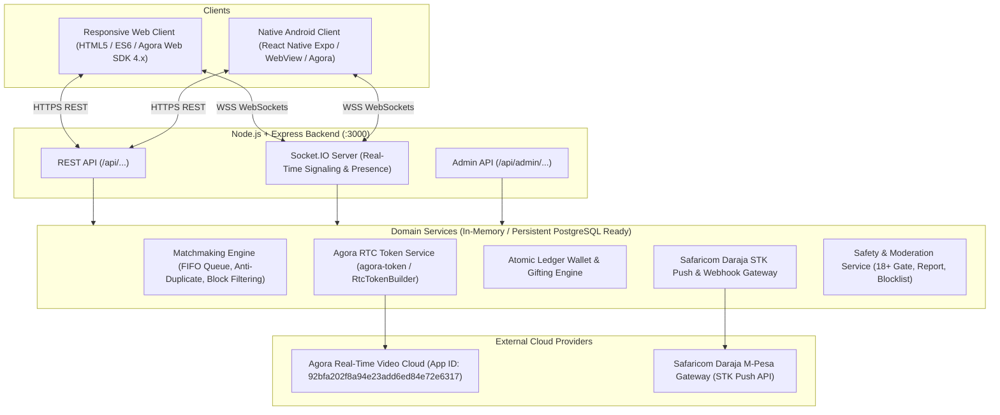

# Jirani Live — System Architecture & Database Schema

## 1. System Architecture Overview



---

## 2. Relational Database Schema (PostgreSQL / Supabase Compatible)

```sql
-- 1. Users and Profiles
CREATE TABLE users (
    id VARCHAR(64) PRIMARY KEY,
    username VARCHAR(50) UNIQUE NOT NULL,
    display_name VARCHAR(100) NOT NULL,
    age INT NOT NULL CHECK (age >= 18),
    gender VARCHAR(20) NOT NULL,
    city VARCHAR(50) DEFAULT 'Nairobi',
    country VARCHAR(10) DEFAULT 'KE',
    avatar_url TEXT,
    bio TEXT,
    verified BOOLEAN DEFAULT FALSE,
    role VARCHAR(20) DEFAULT 'user' CHECK (role IN ('user', 'anchor', 'admin')),
    status VARCHAR(20) DEFAULT 'offline' CHECK (status IN ('offline', 'online', 'busy', 'banned')),
    created_at TIMESTAMP WITH TIME ZONE DEFAULT NOW(),
    updated_at TIMESTAMP WITH TIME ZONE DEFAULT NOW()
);

-- 2. User Presence and Sockets
CREATE TABLE user_sessions (
    id VARCHAR(64) PRIMARY KEY,
    user_id VARCHAR(64) REFERENCES users(id) ON DELETE CASCADE,
    socket_id VARCHAR(100) NOT NULL,
    ip_address VARCHAR(45),
    user_agent TEXT,
    is_active BOOLEAN DEFAULT TRUE,
    connected_at TIMESTAMP WITH TIME ZONE DEFAULT NOW(),
    last_ping_at TIMESTAMP WITH TIME ZONE DEFAULT NOW()
);

-- 3. Matchmaking Queue & Active 1v1 Sessions
CREATE TABLE match_sessions (
    id VARCHAR(64) PRIMARY KEY,
    channel_name VARCHAR(128) UNIQUE NOT NULL,
    user_a_id VARCHAR(64) REFERENCES users(id),
    user_b_id VARCHAR(64) REFERENCES users(id),
    user_a_uid INT NOT NULL,
    user_b_uid INT NOT NULL,
    started_at TIMESTAMP WITH TIME ZONE DEFAULT NOW(),
    ended_at TIMESTAMP WITH TIME ZONE,
    end_reason VARCHAR(50) CHECK (end_reason IN ('skip_user_a', 'skip_user_b', 'hangup_user_a', 'hangup_user_b', 'disconnect', 'report', 'timeout')),
    duration_seconds INT DEFAULT 0,
    status VARCHAR(20) DEFAULT 'active' CHECK (status IN ('pairing', 'active', 'ended'))
);

CREATE INDEX idx_match_sessions_status ON match_sessions(status);
CREATE INDEX idx_match_sessions_users ON match_sessions(user_a_id, user_b_id);

-- 4. Virtual Coin Wallets & Immutable Ledger
CREATE TABLE wallets (
    user_id VARCHAR(64) PRIMARY KEY REFERENCES users(id) ON DELETE CASCADE,
    balance INT NOT NULL DEFAULT 100 CHECK (balance >= 0),
    total_recharged_kes INT NOT NULL DEFAULT 0,
    total_spent_coins INT NOT NULL DEFAULT 0,
    updated_at TIMESTAMP WITH TIME ZONE DEFAULT NOW()
);

CREATE TABLE wallet_ledger (
    id VARCHAR(64) PRIMARY KEY,
    wallet_user_id VARCHAR(64) REFERENCES wallets(user_id) ON DELETE CASCADE,
    transaction_type VARCHAR(30) NOT NULL CHECK (transaction_type IN ('recharge', 'gift_sent', 'gift_received', 'admin_credit', 'admin_debit', 'welcome_bonus')),
    amount_coins INT NOT NULL, -- positive for credit, negative for debit
    balance_after INT NOT NULL,
    reference_id VARCHAR(100), -- order_id or gift_id
    description TEXT,
    created_at TIMESTAMP WITH TIME ZONE DEFAULT NOW()
);

CREATE INDEX idx_wallet_ledger_user ON wallet_ledger(wallet_user_id);

-- 5. Virtual Gift Catalog & Transfers
CREATE TABLE gift_catalog (
    id VARCHAR(32) PRIMARY KEY,
    name VARCHAR(50) NOT NULL,
    emoji VARCHAR(20) NOT NULL,
    price_coins INT NOT NULL CHECK (price_coins > 0),
    animation_type VARCHAR(30) DEFAULT 'float_glow',
    is_active BOOLEAN DEFAULT TRUE
);

CREATE TABLE gift_transactions (
    id VARCHAR(64) PRIMARY KEY,
    sender_id VARCHAR(64) REFERENCES users(id),
    recipient_id VARCHAR(64) REFERENCES users(id),
    gift_id VARCHAR(32) REFERENCES gift_catalog(id),
    match_session_id VARCHAR(64) REFERENCES match_sessions(id),
    coins_amount INT NOT NULL,
    created_at TIMESTAMP WITH TIME ZONE DEFAULT NOW()
);

-- 6. Safaricom M-Pesa Daraja Payment Orders
CREATE TABLE payment_orders (
    id VARCHAR(64) PRIMARY KEY,
    user_id VARCHAR(64) REFERENCES users(id),
    package_id VARCHAR(32) NOT NULL,
    coins_awarded INT NOT NULL,
    amount_kes DECIMAL(10,2) NOT NULL,
    phone_number VARCHAR(15) NOT NULL,
    merchant_request_id VARCHAR(100),
    checkout_request_id VARCHAR(100) UNIQUE,
    mpesa_receipt_number VARCHAR(100) UNIQUE,
    status VARCHAR(20) DEFAULT 'pending' CHECK (status IN ('pending', 'completed', 'failed', 'cancelled', 'timeout')),
    result_code INT,
    result_desc TEXT,
    idempotency_key VARCHAR(128) UNIQUE,
    created_at TIMESTAMP WITH TIME ZONE DEFAULT NOW(),
    updated_at TIMESTAMP WITH TIME ZONE DEFAULT NOW()
);

-- 7. Safety: Blocklist & Moderation Reports
CREATE TABLE user_blocks (
    id VARCHAR(64) PRIMARY KEY,
    blocker_id VARCHAR(64) REFERENCES users(id) ON DELETE CASCADE,
    blocked_id VARCHAR(64) REFERENCES users(id) ON DELETE CASCADE,
    created_at TIMESTAMP WITH TIME ZONE DEFAULT NOW(),
    UNIQUE(blocker_id, blocked_id)
);

CREATE TABLE moderation_reports (
    id VARCHAR(64) PRIMARY KEY,
    reporter_id VARCHAR(64) REFERENCES users(id),
    reported_user_id VARCHAR(64) REFERENCES users(id),
    match_session_id VARCHAR(64),
    reason_category VARCHAR(50) NOT NULL,
    details TEXT,
    screenshot_url TEXT,
    status VARCHAR(20) DEFAULT 'pending' CHECK (status IN ('pending', 'reviewed', 'action_taken', 'dismissed')),
    action_notes TEXT,
    resolved_by VARCHAR(64),
    created_at TIMESTAMP WITH TIME ZONE DEFAULT NOW(),
    resolved_at TIMESTAMP WITH TIME ZONE
);
```

---

## 3. Real-Time Socket.IO Signaling Events

| Event Name | Direction | Payload | Description |
| :--- | :--- | :--- | :--- |
| `user:register` | Client -> Server | `{ userId, username, city, avatar }` | Establishes client identity and updates presence. |
| `queue:join` | Client -> Server | `{ filterCity, filterGender }` | Enters the FIFO random video matchmaking queue. |
| `queue:leave` | Client -> Server | `{}` | Cancels matchmaking search. |
| `match:found` | Server -> Client | `{ sessionId, channelName, remoteUser, localUid, remoteUid, agoraToken, appId }` | Emitted when two compatible users are paired. |
| `match:skip` | Client -> Server | `{ sessionId }` | Skips current match; re-enters queue or resets. |
| `match:ended` | Client -> Server / Server -> Client | `{ sessionId, reason }` | Informs participants that call has terminated. |
| `call:direct_request` | Client -> Server | `{ targetUserId }` | Initiates direct 1v1 video call with online anchor. |
| `call:direct_incoming`| Server -> Client | `{ callerUser, sessionId, channelName, agoraToken, localUid, remoteUid }` | Informs recipient of incoming 1v1 call. |
| `chat:in_call_message`| Client <-> Server | `{ sessionId, text, timestamp }` | Broadcasts text messages and quick replies during call. |
| `gift:send` | Client -> Server | `{ sessionId, recipientId, giftId }` | Validates coins, deducts balance, triggers animation. |
| `gift:received` | Server -> Client | `{ gift, senderName, newBalance }` | Broadcasts floating gift notification and updates recipient. |
| `user:block` | Client -> Server | `{ targetUserId }` | Instantly severs call and blacklists pair from matching. |
